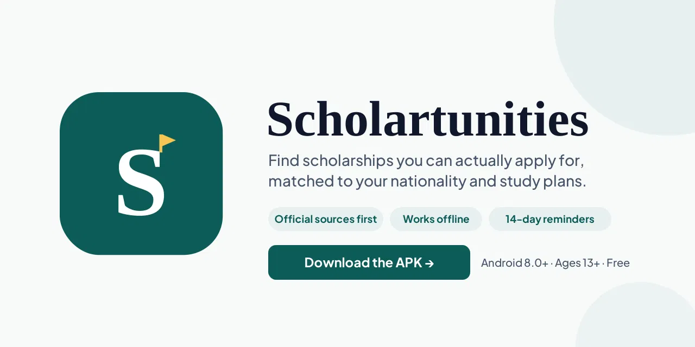
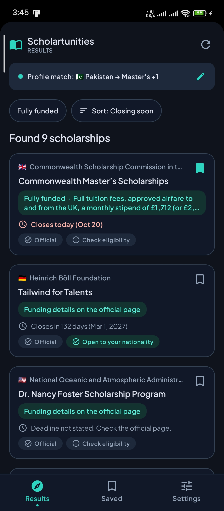
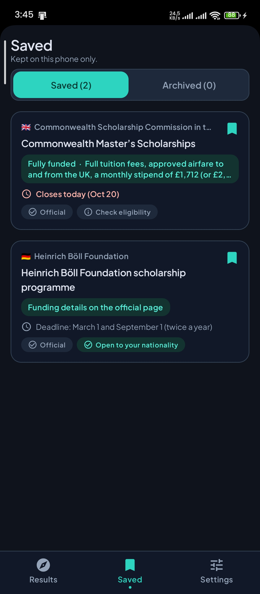
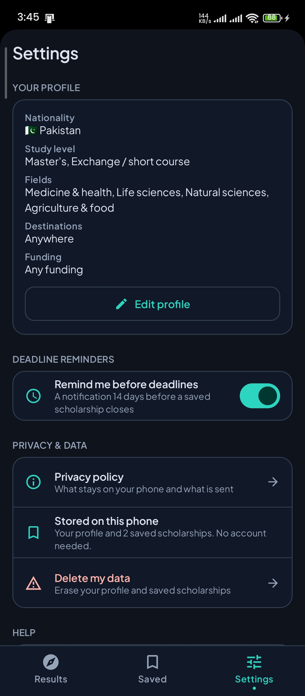

<!--
  README.md: the front page of the Scholartunities app repository on GitHub.
  Images live in /docs: Scholartunities.png (banner, 1280x640), icon_512.png,
  and screenshots/ (results.jpg, saved.jpg, settings.jpg).
  Links to "../../releases/latest" always open the newest GitHub Release,
  so this file doesn't need changing for each new version.
-->

  

  
  &nbsp;
  
  &nbsp;
  

# Scholartunities

**Find scholarships you can actually apply for, matched to your nationality and study plans.**

Scholartunities is a free Android app for students aged 13 and over. Tell it where you're from, what you want to study and where, and it shows scholarships from around the world. Official sources come first, every deadline is counted down, and there are clear warnings when something needs a second look.

## ⬇️ Download

**[Get the latest version from Releases →](../../releases/latest)**

Download the file named `Scholartunities-<version>.apk` from the **Assets** list.

### How to install

1. Open the downloaded `.apk` on your Android phone.
2. If Android asks, allow **"Install unknown apps"** for your browser or file manager. This is needed for any app that doesn't come from the Play Store.
3. Android may show a **Play Protect** notice for apps from outside the Play Store. Choose **Install anyway**.
4. Open Scholartunities, confirm you're 13 or older, and set up your profile in five quick steps.

**Updating:** download the newer APK from Releases and install it over the old one. Your profile and saved scholarships are kept.

### Check your download (optional)

Each release lists a **SHA-256** checksum. To confirm the file you downloaded is exactly the one published, compare the checksums:

- **Windows:** `certutil -hashfile Scholartunities-1.0.0.apk SHA256`
- **macOS / Linux:** `shasum -a 256 Scholartunities-1.0.0.apk`

## 📱 Screenshots

  
  &nbsp;
  
  &nbsp;
  

Results · Saved · Settings

## ✨ What it does

- **Matched results:** filtered by your nationality, study level, subjects and destination countries, with a *Fully funded* filter.
- **Honest badges:** *Official* source, *Open to your nationality*, *Check eligibility* when the rules aren't clear, and a *Fee warning* when a page asks for an application fee.
- **Deadline countdown:** "Closes in 9 days" turns red in the last 14 days.
- **Save for later:** bookmarked scholarships work **offline**, and closed ones move to *Archived*.
- **Reminders (optional):** a notification 14 days before a saved scholarship closes.
- **Open the official page** in one tap to read the full rules and apply.
- **Report a problem** with any listing straight from the app.

## 🔒 Privacy, in short

- **No account.** No name, email, phone number or location is asked for.
- Your profile and saved scholarships **stay on your phone**.
- To search, the app sends only your **filter choices** (nationality code, study levels, subjects, countries).
- **No ads, no analytics, no tracking** in this version.
- **Settings → Delete my data** erases everything at once.

The full privacy policy is inside the app under **Settings → Privacy policy**.

## ⚠️ Please note

Scholarship details are collected automatically from public websites, with official sources preferred. They can be incomplete or change at any time. **Always confirm the details on the official page before you apply.** Never pay anyone to "guarantee" a scholarship.

## Requirements

- Android **8.0 (Oreo)** or newer
- An internet connection to search (saved scholarships work offline)

## For developers

- **App:** Kotlin, Jetpack Compose (Material 3), Navigation Compose, DataStore, WorkManager, Chrome Custom Tabs. Built in Android Studio; minSdk 26.
- **Backend (separate repo):** a Cloudflare Worker with a D1 database. It collects public scholarship pages on a schedule and serves a small read-only JSON API that the app calls.
- **Build from source:** open the project in Android Studio and run the `app` configuration. Release builds are signed with a private key that is not in this repository.

## Feedback

Found an outdated or wrong scholarship? Use **Report a problem with this listing** on its page in the app, or **Settings → Report an outdated scholarship**.

---

Scholartunities · made by Dev.811 (Ahmed Hassan)

